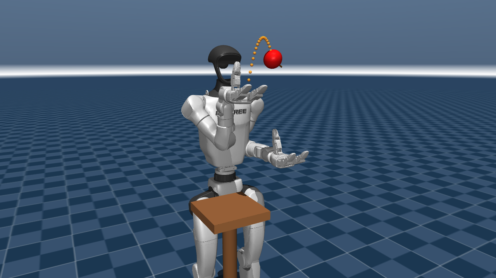

# Unitree G1 Apple Toss in MuJoCo

A Unitree G1 humanoid (29-DoF body with Dex3 three-finger hands) picks an apple off a table with its right hand, turns it palm-up, tosses it in an arc and catches it in its left hand. The left hand re-plans the catch point every control tick from the apple's measured position and velocity, then cushions the impact.

**ME206 assignment, Problem 3** · Team: Divya Rahul Shah, Armaan Dixit, Om Mohan Pawar

- **Video:** <https://youtu.be/DhcrIo_bmR8>
- **Repository:** <https://github.com/shahdivya-lab/g1-apple-toss>



All motion is physical. The joints are driven by the G1's position servos with the Menagerie gains and torque limits, the grasp is held by finger friction alone, and the apple leaves the hand because the hand brakes harder than gravity. The behaviour is a hand-designed controller; there is no learning or training involved.

---

## Contents

1. [Requirements](#1-requirements)
2. [Installation](#2-installation)
3. [Running the simulation](#3-running-the-simulation)
4. [Results](#4-results)
5. [How it works](#5-how-it-works)
6. [Files](#6-files)
7. [Modelling choices and limitations](#7-modelling-choices-and-limitations)
8. [Credits](#8-credits)

---

## 1. Requirements

| Software | Version | Notes |
|---|---|---|
| Python | 3.10 or newer (tested 3.13.9) | |
| [MuJoCo](https://github.com/google-deepmind/mujoco) | 3.2 or newer (tested 4.0.1) | `pip install mujoco` |
| NumPy | tested 2.3.5 | |
| imageio + imageio-ffmpeg | tested 2.37.2 / 0.8.1 | Writes the MP4 video. imageio-ffmpeg includes its own ffmpeg. |
| [MuJoCo Menagerie](https://github.com/google-deepmind/mujoco_menagerie) | `unitree_g1` folder | The G1 robot model. Downloaded separately (step 2). |
| git | any | Used only to download Menagerie |

Operating systems: tested on **Windows 11**. Linux and macOS are supported by MuJoCo. On Linux the code selects EGL for headless rendering automatically, so videos render without a display.

No GPU is needed. One run takes about 30 seconds on a laptop CPU.

## 2. Installation

```bash
git clone https://github.com/shahdivya-lab/g1-apple-toss.git
cd g1-apple-toss

# (optional) virtual environment
python -m venv .venv
# Windows: .venv\Scripts\activate      Linux/macOS: source .venv/bin/activate

pip install -r requirements.txt
```

Then download the Unitree G1 model. Only the `unitree_g1` folder of Menagerie is needed (about 55 MB), and it must sit next to the Python files:

```bash
git clone --filter=blob:none --sparse https://github.com/google-deepmind/mujoco_menagerie.git
cd mujoco_menagerie
git sparse-checkout set unitree_g1
git checkout 370c43965323c0944b433b202aac5058b5f907a9   # the Menagerie version this project was tested with
cd ..
```

The model is loaded from `mujoco_menagerie/unitree_g1/g1_with_hands.xml`. If Menagerie is somewhere else, set the `MENAGERIE` environment variable to its path.

Check the setup:

```bash
python g1_scene.py
```

This builds the scene, runs 300 physics steps and saves a picture as `g1_scene.png`. Expected output: `nq 50 nu 43 apple [ 0.3  -0.13  0.81]`.

## 3. Running the simulation

```bash
python apple_toss_g1.py                        # full run -> apple_toss_g1.mp4 (front camera, 2x slow motion during the toss)
python apple_toss_g1.py --camera wide --slowmo 3
python apple_toss_g1.py --trials 20            # robustness test: 20 runs with a jittered apple, no video
python apple_toss_g1.py --no-video             # run once and print the event log only
python apple_toss_g1.py --view                 # interactive 3D viewer (needs a display)
```

| Option | Default | Meaning |
|---|---|---|
| `--out FILE` | `apple_toss_g1.mp4` | Output video file |
| `--camera` | `front` | `front`, `side`, `wide` or `eyes` (the robot's head camera) |
| `--duration S` | `9.5` | Simulated seconds |
| `--fps N` | `30` | Video frame rate |
| `--slowmo X` | `2.0` | Slow-motion factor applied from just before the throw until just after the catch |
| `--seed N` | none | Shifts the apple's start position by up to ±12 mm and rotates it randomly |
| `--trials N` | `0` | Runs N jittered trials headless and reports how many succeed |
| `--no-video` | off | Simulate without rendering |
| `--view` | off | MuJoCo's interactive viewer. On macOS, run it with `mjpython` instead of `python`. |

Every run ends by printing the event log and the result, for example:

```
t= 6.50s  release  pos [ 0.311 -0.06   1.2  ]  vel [-0.12  0.4   1.61]
t= 6.94s  caught   pos [0.259 0.115 0.962]  flight 0.44s  apex 1.33 m
RESULT: apple caught and held
```

A run counts as a success when the left hand has caught the apple and, at the end, the apple's centre is within 5 cm of the left palm's grip point and more than 0.85 m above the floor.

## 4. Results

Measured on Windows 11, Python 3.13.9, MuJoCo 4.0.1:

| Test | Result |
|---|---|
| Nominal run (`--no-video`) | Released at t = 6.50 s at 1.61 m/s upward; caught at t = 6.94 s after 0.44 s of flight; apex 1.33 m; caught and held |
| Robustness (`--trials 20`, apple position ±12 mm and random yaw) | **20 / 20 caught and held** (seeds 0–19) |

## 5. How it works

The task runs at two rates: physics at 500 Hz (`timestep = 0.002 s`, implicit-fast integrator) and the controller at 250 Hz.

**Phases (right hand)**

| Time (s) | Phase |
|---|---|
| 0 – 1.2 | Hover over the apple, palm down, fingers open |
| 1.2 – 2.0 | Come down until the palm presses lightly (6 mm) on the apple |
| 2.0 – 2.8 | Close the fingers: thumb behind, two fingers in front |
| 2.8 – 3.6 | Lift 15 cm |
| 3.6 – 5.6 | Roll the wrist until the palm faces up |
| 5.6 – 6.2 | Loosen the grip into a cradle |
| 6.2 – 6.45 | Throw: accelerate for 0.25 s to (0, 0.35, 1.60) m/s while the fingers flatten under the apple |
| 6.45 – 6.55 | Brake for 0.10 s with a deceleration greater than g, so the apple leaves the palm |
| after | Move out of the way |

**Left hand.** The left hand waits palm-up at a ready point. Once the apple is detected in free flight (no right-hand contact, rising for 5 consecutive control ticks), the catch point is re-planned every tick by solving the ballistic equation for where the apple will cross the catch height (0.95 m). When the apple touches the left hand, the hand gives way by 8 cm over 0.25 s with an ease-out profile, closes into a cup and presents the apple. The waist turns toward the working hand during the pick and toward the caught apple at the end.

**Arm control**

- **Trajectories:** minimum-jerk interpolation, $10s^3 - 15s^4 + 6s^5$, so velocity and acceleration are zero at both ends of each segment. Orientations are blended with quaternion slerp.
- **Inverse kinematics:** 6-D damped least squares on each 7-DoF arm, solved on a scratch copy of the simulation state so the live simulation is never disturbed. Position and orientation of a "grip" site in the palm are tracked. The one redundant degree of freedom is used in the null space to keep a relaxed posture. Each solve is warm-started from the previous one.
- **Servo command:** the joint target sent to each position actuator includes a velocity feed-forward term, $q_\text{des} + (k_v/k_p)\,\dot q_\text{des}$, and the feed-forward velocity is low-pass filtered so IK noise cannot excite the arm.
- **Fingers:** fixed poses for the Dex3 hand (open, grasp, cup, toss, catch), blended over time. The left hand uses mirrored joint signs.

## 6. Files

| File | Contents |
|---|---|
| `g1_scene.py` | Builds the scene: loads the G1 from Menagerie unchanged, then edits it in code with `MjSpec` (fixed base, gravity compensation, collision groups, friction), and adds the table, the apple, lights, cameras and the palm grip sites |
| `apple_toss_g1.py` | The task: hand trajectories, IK, ballistic catch planning, contact detection, video rendering, trials and the viewer |
| `requirements.txt` | Python dependencies |
| `docs/toss.png` | Still image used above |

## 7. Modelling choices and limitations

- **Fixed base.** The floating base joint is removed, so the pelvis is fixed at standing height and the legs hold straight. Balance is not simulated.
- **Gravity compensation.** Every robot link has `gravcomp = 1`, like the feed-forward gravity torque on the real robot.
- **No self-collision.** Robot links collide with the apple, table and floor but not with each other.
- **Contact model.** Elliptic friction cones with `impratio = 10` stop grasped objects from creeping. Finger pads and palms use friction 1.5.
- **Apple.** A 150 g ellipsoid, 6.6 cm across.
- **Scripted, not learned.** Waypoints, timings and finger poses are hand-designed. Only the catch point adapts online, from the apple's measured state.
- **Simulation only.** It has not been run on hardware. The success rate above holds for the perturbations tested (±12 mm, any yaw); larger changes to the scene may need re-tuning.

## 8. Credits

- Robot model: Unitree G1 with Dex3 hands from [MuJoCo Menagerie](https://github.com/google-deepmind/mujoco_menagerie) (Google DeepMind). It is downloaded separately and not redistributed here; see the license in its `unitree_g1` folder.
- Physics engine: [MuJoCo](https://mujoco.org) (Google DeepMind).
